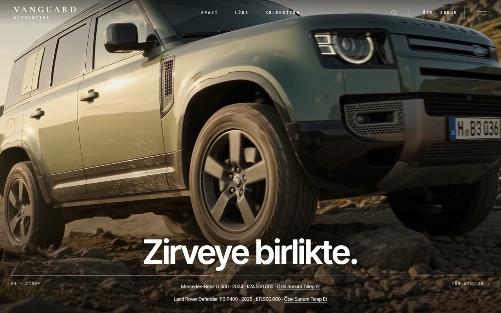
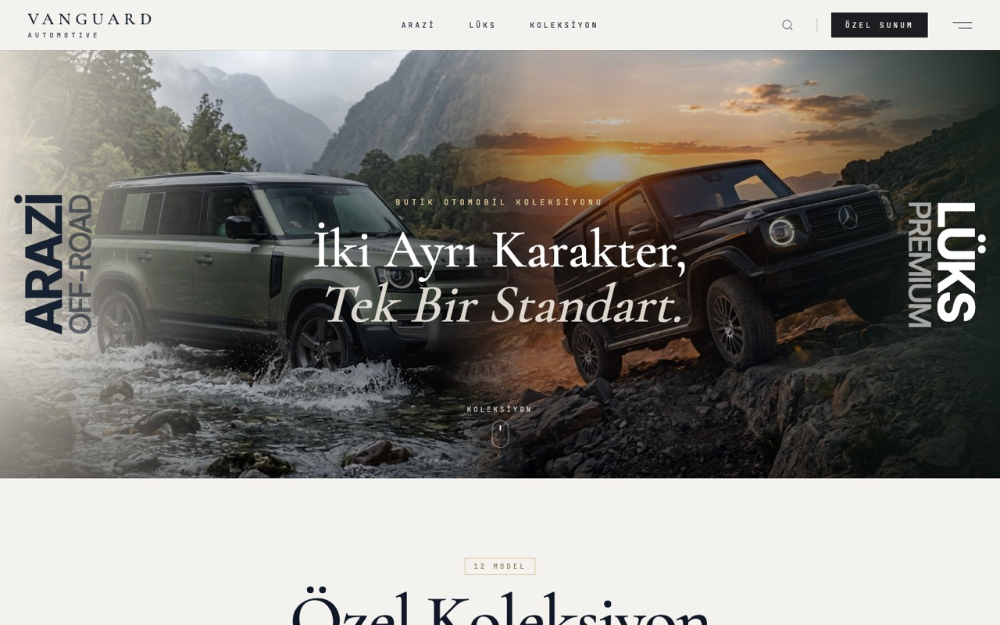
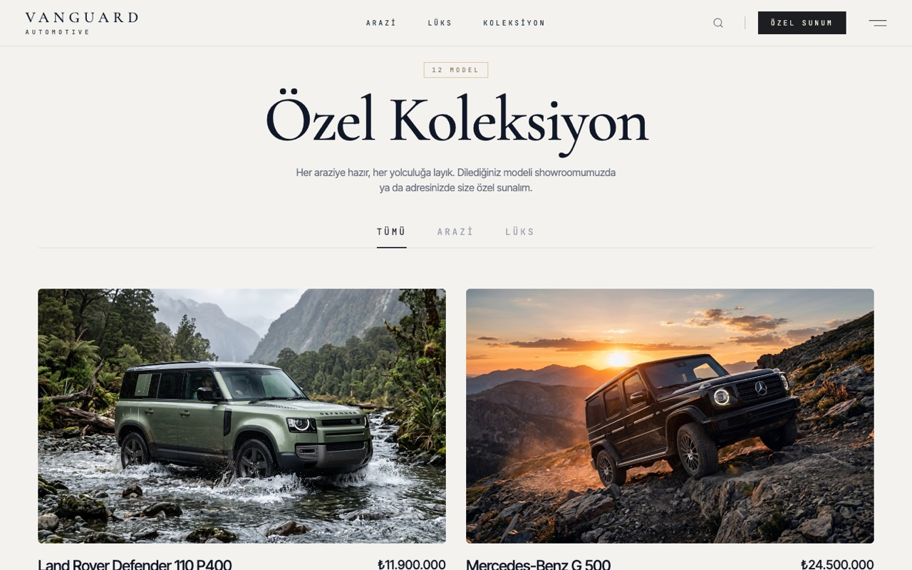
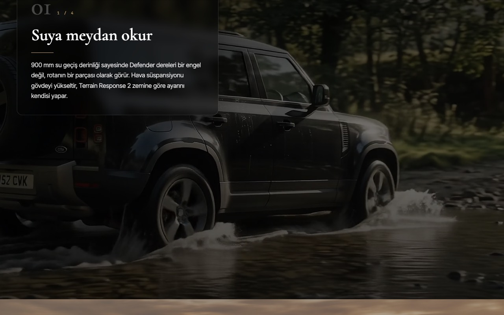
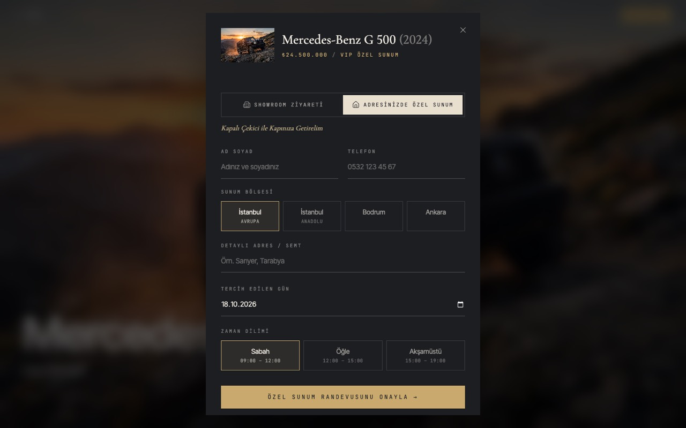
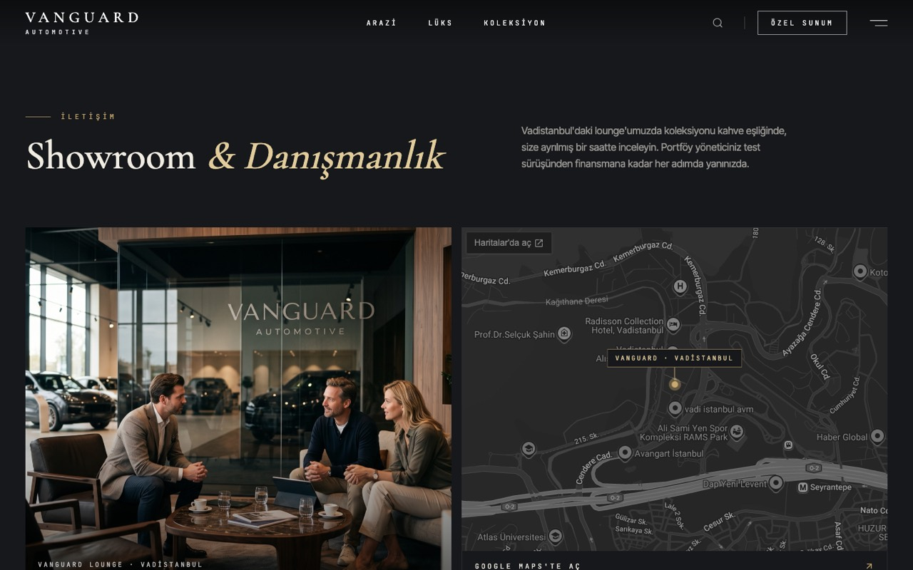
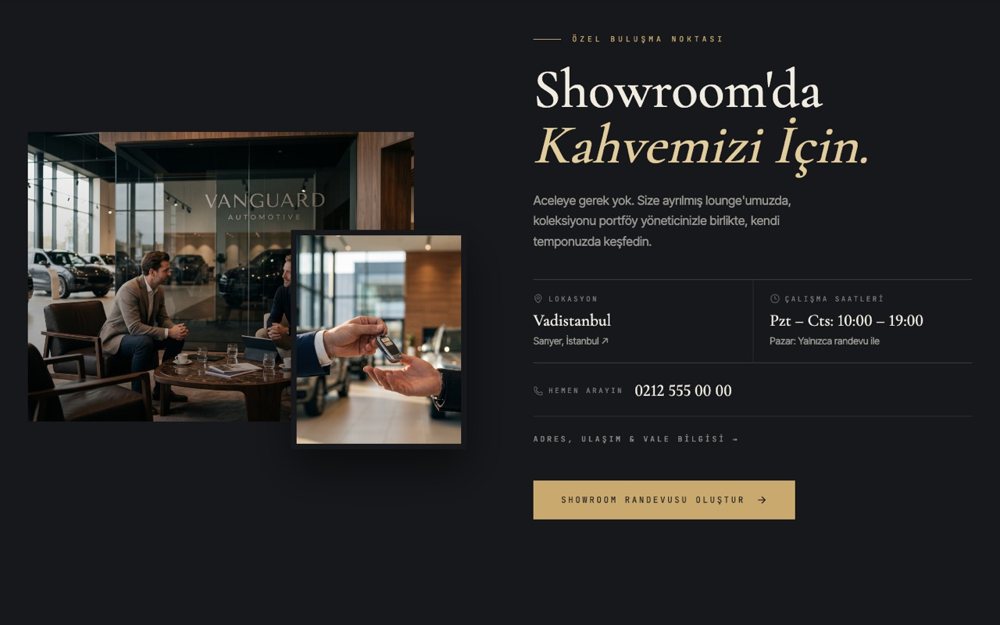
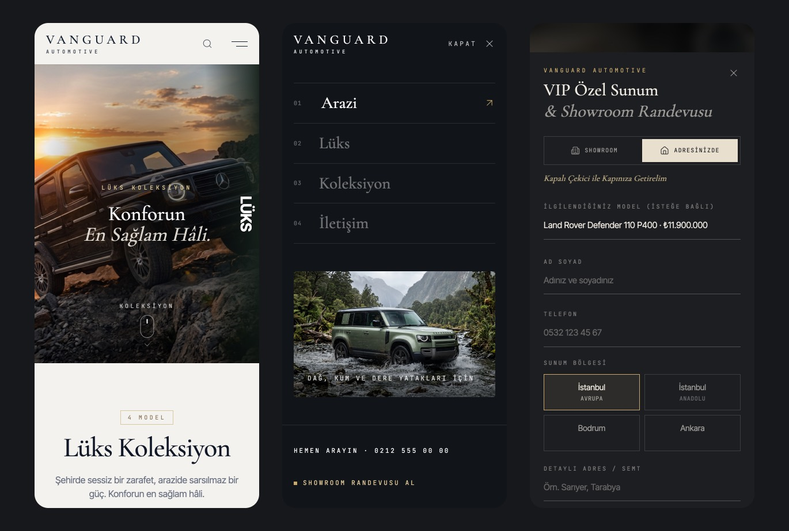

# Vanguard Automotive — Lüks Butik Galeri

Lüks arazi ve SUV araçlar satan hayali bir butik galeri için tasarlanmış, editoryal tarzda bir web sitesi.
Kaydırmaya bağlı video, sinematik detay sayfaları ve "VIP Özel Sunum" randevu akışı içerir.

> **Not:** Bu bir **portfolyo / demo projesidir**. Vanguard Automotive gerçek bir işletme değildir; araçlar, fiyatlar,
> adres ve iletişim bilgileri örnek amaçlıdır.



## Ekran görüntüleri

| Koleksiyon kapağı | Katalog |
| --- | --- |
|  |  |
| **Araç detayı** | **VIP özel sunum randevusu** |
|  |  |
| **İletişim & Showroom** | **Showroom bölümü** |
|  |  |



## Öne çıkan özellikler

- **Kaydırmaya bağlı video:** Ana sayfadaki GMC videosu kaydırdıkça ileri/geri sarılır; sahneye göre başlıklar değişir.
- **Sinematik araç detayı:** Tam ekran görseller ekrana sabitlenir, açıklama kartları buzlu cam efektiyle üstlerine kayar.
  Bir araçta görsel yerine açılış videosu kullanılır.
- **VIP özel sunum randevusu:** Showroom ziyareti / adreste sunum sekmeleri, bölge seçimi, maskeli telefon alanı,
  tarih ve saat dilimi seçimi, onay ekranı. Randevular API'ye kaydedilir.
- **Adres çubuğuna bağlı katmanlar:** Katalog, araç detayı, randevu penceresi ve menü URL'e yansır
  (`/?koleksiyon=arazi&arac=car-1`). Tarayıcının **geri tuşu** her seferinde bir katmanı kapatır, linkler paylaşılabilir.
- **Akıllı arama:** Yazdıkça öneri listesi; marka, model, kategori ve yılda kelime kelime, Türkçe karakterlere duyarsız arama.
- **Kategoriye göre katalog:** Arazi / Lüks / Tümü için ayrı kapak görseli, başlık ve araç listesi.
- **Mobil uyumlu:** 320 px'ten masaüstüne kadar test edildi; yatay taşma yok, dokunma alanları büyütüldü.
- **Erişilebilirlik detayları:** "Hareketi azalt" tercihinde animasyonlar ve otomatik video kapanır; klavye (Esc) desteği.

## Teknolojiler

| Alan | Kullanılanlar |
| --- | --- |
| Ön yüz | React 19, TypeScript, Vite |
| Stil | Tailwind CSS v4 |
| Animasyon | Framer Motion, scroll'a bağlı özel hook'lar |
| Durum & yönlendirme | Zustand, React Router (URL ile senkron katmanlar) |
| İkonlar | lucide-react |
| Backend | Vanguard Automotive API (ayrı depo: `rent-a-car-api`) — Express, SQLite (`node:sqlite`) |

## Kurulum

Gereksinim: **Node.js 22.13+**

```bash
# 1) API (ayrı klasör)
cd ../rent-a-car-api
npm install
npm run dev          # http://localhost:3001

# 2) Site
npm install
npm run dev          # http://localhost:5173
```

API farklı bir adreste çalışıyorsa `.env.local` dosyasında belirtin:

```
VITE_API_URL=http://localhost:3001/api
```

Diğer komutlar: `npm run build` (üretim derlemesi), `npm run lint`.

## Proje yapısı

```text
src/
├── pages/            # HomePage, ContactPage (/iletisim)
├── components/       # Navbar, Hero, ScrollVideo, FleetPage, CarDetailModal, AppointmentModal …
├── hooks/            # useOverlayHistory (URL ↔ katmanlar), useScroll, useRevealOnScroll
├── store/            # Zustand store
├── services/api.ts   # API istemcisi (axios)
├── constants/        # iletişim bilgileri, kategoriler, video ayarları
├── utils/            # biçimlendirme, arama, Türkçe teknik terimler
└── types/            # TypeScript tipleri
public/
├── cars/             # araç görselleri (web için küçültülmüş)
├── experience/       # deneyim ve showroom görselleri
└── hero/             # ana sayfa videoları
```

## Görseller

Araç, showroom ve deneyim görsellerinin çoğu yapay zekâ ile üretilmiştir; bir kısmı [Unsplash](https://unsplash.com)'tan
alınmıştır (Unsplash Lisansı). Görsellerdeki araçlar gerçek ürünleri birebir temsil etmeyebilir. Logolar ve marka adları
ilgili sahiplerine aittir; bu proje herhangi bir otomobil markasıyla ilişkili değildir.
